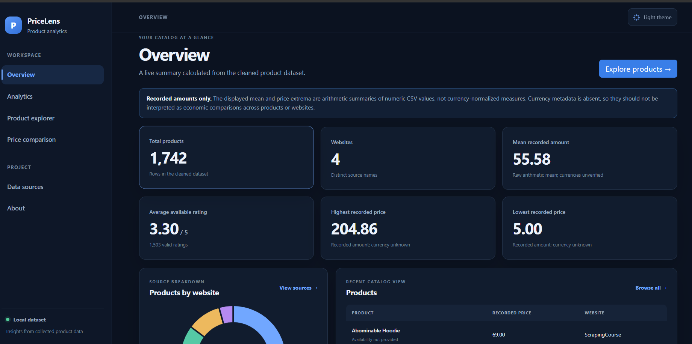
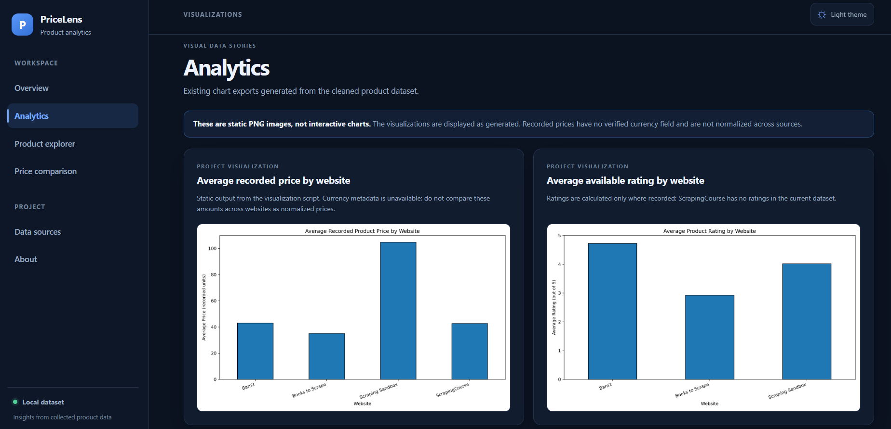
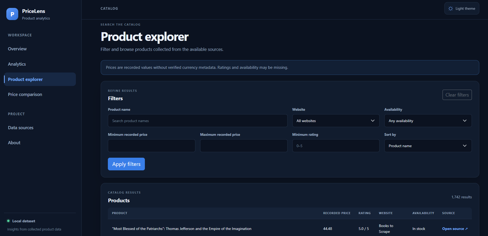
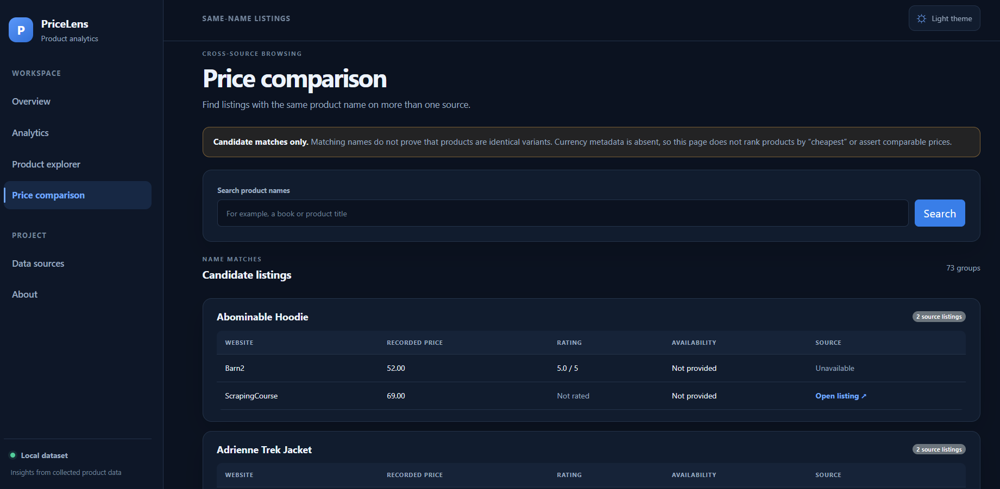

# Product Price Analysis System

A Flask-based product analytics project that collects product listings from multiple websites, combines and cleans their data, generates analysis outputs and charts, and provides a browser-based dashboard for exploring the resulting catalog.

**GitHub:** [eswar-sai-2/Product_Price_Analysis](https://github.com/eswar-sai-2/Product_Price_Analysis)

> **Price limitation:** The dataset does not include a currency field. Prices from different websites might use different currencies and are not necessarily comparable. This project does not convert or normalize currencies.

## Project overview

The project provides a local workflow for collecting product information from four sources and exploring the resulting CSV dataset. Its Flask application uses `data/cleaned_products.csv` as the canonical dataset for the dashboard. Separate Python scripts combine source data, clean fields, produce tabular analyses and visualizations, and generate a batch product-name comparison.

The currently inspected cleaned CSV contains **1,742 product rows**:

| Website name in dataset | Product rows |
|     ---                 |         ---: |
| ScrapingCourse          |  182         |
| Barn2                   |  75          |
| Books to Scrape         |  1,000       |
| Scraping Sandbox        |  485         |

The dashboard calculates its statistics and source counts from the CSV at request time. The values above describe the inspected dataset snapshot and are not hardcoded application values.

## Problem statement

Product listing information is collected separately across different websites. This project brings selected fields into a shared dataset to make the records easier to clean, summarize, visualize, search, and inspect. Differences in source coverage and missing values mean that the combined dataset is not a complete or standardized market-price feed.

## Objectives

- Collect product listing information using the project's source-specific scrapers.
- Combine the source CSVs while recording each source website.
- Normalize available text, price, rating, availability, and scrape-date fields.
- Generate descriptive analysis tables and static charts from the cleaned dataset.
- Provide a Flask dashboard for browsing the current dataset and viewing analysis.
- Preserve source product links where they are available and safe to open.

## Flask dashboard features

- Dynamically calculated overview metrics: product count, distinct websites, mean recorded price, mean valid rating, and recorded price extrema.
- Website product counts and a data-driven interactive doughnut chart.
- Product search and filters for website, recorded price range, rating, and availability.
- Product sorting and pagination.
- Source-link buttons for valid HTTP(S) product URLs.
- Five existing visualization PNGs displayed as **static images** on the Analytics page.
- Name-based candidate listing groups on the comparison page; a matching name is not proof of an identical product variant.
- Data-source counts, available scrape dates, and the columns present in the canonical dataset.
- Project information, responsive navigation, a light/dark theme toggle, and missing-data/error displays.

The dashboard's interactive chart uses Chart.js and values computed from the CSV. The five images on the Analytics page are the Matplotlib outputs described below; they are not interactive charts.

## Technologies

- **Python**
- **Flask** and **Jinja** for the web application and templates
- **Pandas** for CSV loading, cleaning, grouping, and analysis
- **Playwright** for browser-based collection in the scraper scripts
- **Matplotlib** for static chart generation
- **Bootstrap**, custom CSS, and JavaScript for the responsive interface
- **Chart.js** for the interactive website-count chart on the dashboard

Python package dependencies are listed in [`requirements.txt`](requirements.txt). Bootstrap and Chart.js are loaded from CDNs, so those browser assets require an internet connection.

## 📂 Project Structure

```text
Product_Price_Analysis/
├── app.py
├── README.md
├── requirements.txt
├── analysis/
│   ├── analyze_products.py
│   └── combine_datasets.py
├── cleaning/
│   └── data_cleaning.py
├── comparison/
│   ├── compare_products.py
│   └── matched_product_comparison.csv
├── data/
│   ├── barn2_products.csv
│   ├── books_products.csv
│   ├── scrapingcourse_products.csv
│   ├── scrapingsandbox_products.csv
│   ├── all_products.csv
│   ├── cleaned_products.csv
│   ├── availability_analysis.csv
│   ├── top_10_expensive_products.csv
│   └── website_analysis.csv
├── scraping/
│   ├── barn2_scraper.py
│   ├── books_scraper.py
│   ├── scrapingcourse_scraper.py
│   └── scrapingsandbox_scraper.py
├── static/
│   ├── css/
│   │   └── app.css
│   └── js/
│       ├── app.js
│       └── charts.js
├── templates/
│   ├── about.html
│   ├── analytics.html
│   ├── base.html
│   ├── comparison.html
│   ├── data_sources.html
│   ├── error.html
│   ├── index.html
│   └── product.html
├── tests/
│   └── test_app.py
└── visualizations/
    ├── average_price_by_website.png
    ├── average_rating_by_website.png
    ├── price_distribution.png
    ├── product_count_by_website.png
    └── top_10_expensive_products.png
```

The `data/` directory also contains additional CSV files from earlier or generated workflows. The current application reads `cleaned_products.csv`; the four source CSVs listed above are the inputs expected by the current combine script.

## 🌟 Project Highlights

- 🌐 Collect product data from four websites.
- 🧹 Clean and organize data using Pandas.
- 📊 Analyze product prices, ratings, and website statistics.
- 📈 Generate five visualizations using Matplotlib.
- 🖥️ Explore the dataset through a Flask dashboard.
- 🔍 Search, filter, sort, and compare product listings.

## Web scraping workflow

Each scraper is a separate script under `scraping/`. The scripts use Playwright's synchronous API and launch Chromium in headless mode to visit their configured source and collect product fields. They save source-specific CSV files under `data/`:

| Script                               | Source label   | Output CSV                         |
| ---                                  | ---            | ---                                |
| `scraping/scrapingcourse_scraper.py` | ScrapingCourse | `data/scrapingcourse_products.csv` |
| `scraping/barn2_scraper.py`          | Barn2          | `data/barn2_products.csv`          |
| `scraping/books_scraper.py`          | Books to Scrape| `data/books_products.csv`          |
| `scraping/scrapingsandbox_scraper.py`| Scraping Sandbox| `data/scrapingsandbox_products.csv`|

Scraping is a manual step. The Flask application does not run scrapers automatically. Running a scraper contacts its configured website and may replace that scraper's output CSV with newly collected data.

## Data cleaning and analysis workflow

### Combine source CSVs

`analysis/combine_datasets.py` reads the four source CSVs listed above, sets a `Website_Name` for each source, concatenates the records, checks that the per-source counts are preserved, and writes `data/all_products.csv`.

### Clean combined data

`cleaning/data_cleaning.py` reads `data/all_products.csv` and writes the canonical `data/cleaned_products.csv`. It trims available text, converts prices and ratings to numeric values, treats negative prices and ratings outside 0–5 as missing, parses scrape dates, and normalizes common yes/no availability values. It also checks that row counts, source counts, and columns are preserved. This step overwrites the canonical cleaned CSV.

The current cleaned CSV columns are:

`Product_Name`, `Product_Price`, `Product_Rating`, `Product_URL`, `Website_Name`, `Date_Scraped`, and `Availability`.

### Run analysis scripts

- `analysis/analyze_products.py` prints overall and website-level summaries and writes `website_analysis.csv`, `availability_analysis.csv`, and `top_10_expensive_products.csv` under `data/`.
- `comparison/compare_products.py` groups exact product names for Barn2 and ScrapingCourse, retains names present on both, and writes `comparison/matched_product_comparison.csv`. It calculates a numeric price difference and a lower recorded-price label. These are **not reliable cross-site price conclusions** unless product variants and currencies are verified; the script itself does not perform that verification.
- `visualizations/visualize_products.py` reads `data/cleaned_products.csv` and writes five PNG files to `visualizations/`.

The analysis and visualization scripts are separate from the Flask request flow. Running them is not required to start the dashboard if the cleaned CSV and existing chart images are already available.

## Visualizations

`visualizations/visualize_products.py` uses Pandas and Matplotlib to calculate website summaries and save the following static charts:

1. **Average price by website** (`average_price_by_website.png`) — a bar chart of the mean recorded price per website. Currencies are not identified or normalized.
2. **Average rating by website** (`average_rating_by_website.png`) — a bar chart of the available mean ratings, on the script's 0–5 scale. Websites without recorded ratings may not appear.
3. **Price distribution** (`price_distribution.png`) — a histogram of numeric recorded prices using 20 bins. The amounts have no verified currency unit.
4. **Product count by website** (`product_count_by_website.png`) — a bar chart of product counts grouped by website.
5. **Top 10 expensive products** (`top_10_expensive_products.png`) — a horizontal bar chart of the ten largest recorded price values and their product names.

The visualizations script saves these PNGs and calls Matplotlib's `show()` for each figure. The dashboard displays the existing files rather than generating duplicate image charts.

## 🖥️ Dashboard Pages

The project includes the following pages to explore product data and analysis.

### 🏠 1. Overview
**Route:** `/`

- Displays dynamic key performance indicators (KPIs).
- Shows product counts for each website.
- Includes an interactive Chart.js chart.
- Displays a summary of product listings.

### 📊 2. Analytics
**Route:** `/analytics`

- Displays five static charts generated using Matplotlib.
- Shows average prices and ratings by website.
- Visualizes price distribution and product counts.
- Displays the top 10 most expensive recorded products.

### 🔍 3. Product Explorer
**Route:** `/products`

- Search products by name.
- Filter products by website, price range, rating, and availability.
- Sort products by name, price, or rating.
- Browse products using pagination.
- Open valid product source links.

### ⚖️ 4. Price Comparison
**Route:** `/comparison`

- Identifies potential matching products using normalized product names.
- Displays recorded product information from multiple websites.
- Helps inspect matching product listings.

**Note:** Matching names do not guarantee identical products, and prices may use different currencies.

### 🌐 5. Data Sources
**Route:** `/data-sources`

- Displays product counts for each website.
- Shows available scraping dates.
- Lists the columns in the cleaned dataset.

### ℹ️ 6. About
**Route:** `/about`

- Provides an overview of the project.
- Describes the technologies used.
- Explains the project workflow and limitations.
- Includes repository information.

Prices are displayed as recorded amounts. They may represent different currencies, and the application does not claim cross-website price comparability. Product names in the comparison page are candidates only; the application cannot verify product variants.

## 🛠️ Installation

Follow these steps to set up and run the project.

### 🪟 Windows (PowerShell)

**1. Create a virtual environment**

```powershell
py -m venv .venv
```

**2. Activate the virtual environment**

```powershell
.\.venv\Scripts\Activate.ps1
```

**3. Upgrade pip**

```powershell
python -m pip install --upgrade pip
```

**4. Install dependencies**

```powershell
python -m pip install -r requirements.txt
```

If PowerShell blocks activation, use:

```powershell
.\.venv\Scripts\python.exe -m pip install -r requirements.txt
```

### 🐧 macOS / Linux

**1. Create a virtual environment and activate it**

```bash
python3 -m venv .venv
source .venv/bin/activate
```

**2. Upgrade pip and install dependencies**

```bash
python -m pip install --upgrade pip
python -m pip install -r requirements.txt
```

### 🌐 Install Playwright Chromium

To run the web scraping scripts, install the Chromium browser:

```bash
python -m playwright install chromium
```

---

## ▶️ Run the Application

**Step 1: Check the dataset**

Make sure this file exists:

```text
data/cleaned_products.csv
```

**Step 2: Start the Flask application**

Run this command from the project root:

```bash
python app.py
```

**Step 3: Open the dashboard**

Visit the following address in your browser:

**http://127.0.0.1:5000/**

The application reads product information from `data/cleaned_products.csv`. It does not automatically scrape websites when the dashboard starts.

## 🔄 Run the Data Pipeline

Run these commands from the project root in the order shown below.

> ⚠️ **Important:** These scripts can overwrite existing CSV files. Back up any data you need to preserve before running the pipeline.

### Step 1: Scrape Product Data

```bash
python scraping/scrapingcourse_scraper.py
python scraping/barn2_scraper.py
python scraping/books_scraper.py
python scraping/scrapingsandbox_scraper.py
```

### Step 2: Combine Datasets

```bash
python analysis/combine_datasets.py
```

### Step 3: Clean the Dataset

```bash
python cleaning/data_cleaning.py
```

### Step 4: Generate Analysis Reports

```bash
python analysis/analyze_products.py
```

### Step 5: Compare Products

```bash
python comparison/compare_products.py
```

### Step 6: Generate Visualizations

```bash
python visualizations/visualize_products.py
```

### Step 7: Run Tests

```bash
python -m unittest discover -s tests -v
```

## Application Screenshots

### Dashboard


### Analytics


### Product Explorer


### Price Comparison


## Limitations and future improvements

### Current limitations

- The dataset has no currency column. Prices from different websites might use different currencies and are not necessarily comparable; no conversion is performed.
- Equal or similar product names do not establish that listings refer to the same product variant, package, or specification.
- Ratings, availability, and other fields can be missing or vary by source.
- The dashboard uses a local CSV snapshot. Displayed scrape dates are dataset values and do not indicate a live website connection.
- Web scraping depends on the current structure and availability of each source website; page changes can require scraper updates.
- The five Analytics-page charts are static images. They are regenerated by the visualization script, not updated interactively on that page.

### Possible future improvements

- Collect and validate explicit currency and product-variant information before making cross-site price comparisons.
- Add automated data-quality checks for each source and make scraper changes easier to detect.
- Retain dated dataset snapshots to analyze changes over time.
- Expand tests to cover the scraping, cleaning, and analysis pipeline.
- Add accessible interactive versions of additional charts using verified dataset fields.
- Document source-specific scraping behavior and refresh cadence as these are established.
